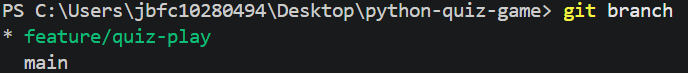
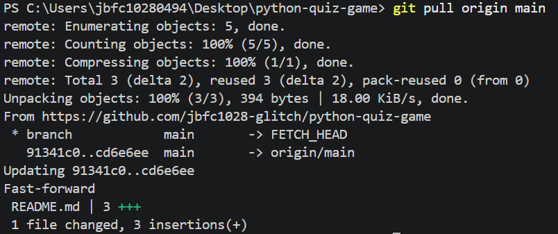
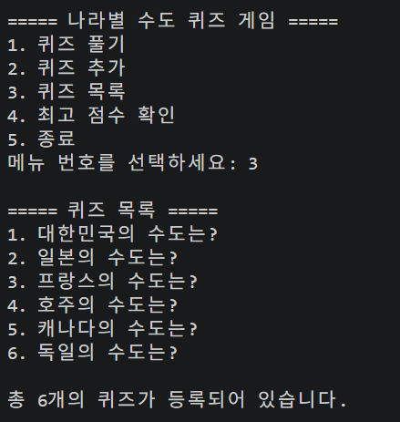
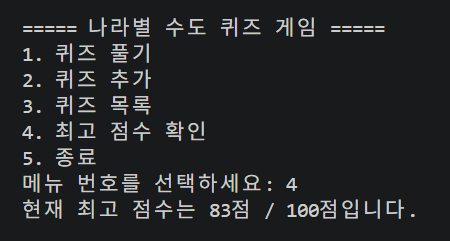
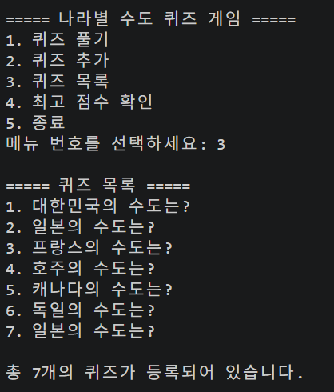

# Python Quiz Game 

Python으로 제작한 터미널 기반 세계 수도 퀴즈 게임입니다.

사용자는 세계 여러 나라의 수도를 맞히는 4지선다형 퀴즈를 풀고, 새로운 문제를 직접 추가할 수 있습니다.

## 프로젝트 목표

- Python 기본 문법과 입출력 학습
- 클래스와 객체를 활용한 프로그램 구조화
- JSON 파일을 이용한 데이터 영속성 구현
- Git과 GitHub를 이용한 버전 관리
- 기능별 개발 및 브랜치 병합 경험

## 퀴즈 주제 선정 이유

세계 여러 나라의 수도는 누구나 쉽게 접할 수 있는
친숙한 주제이기 때문에 선택했습니다.

문제를 직접 만들기 쉽고, 4지선다형 퀴즈로 구현하기에도
적합하다고 생각했습니다.

또한 다양한 나라의 수도를 학습하면서
프로그래밍을 재미있게 연습할 수 있다는 장점이 있습니다.

## 주요 기능

1. 퀴즈 플레이
   - 세계 수도에 관한 4지선다형 문제
   - 정답 및 오답 확인
   - 100점 만점 점수 계산

2. 퀴즈 추가
   - 사용자가 직접 문제 작성
   - 선택지 4개 입력
   - 정답 번호 지정

3. 퀴즈 목록
   - 등록된 문제 확인
   - 전체 문제 개수 확인

4. 최고 점수 확인
   - 최고 점수 기록 및 갱신
   - JSON 파일에 최고 점수 저장

5. 게임 종료
   - 퀴즈와 최고 점수를 state.json에 저장

## 실행 방법

Python 3가 설치되어 있어야 합니다.

1. GitHub 저장소 복제

```bash
git clone https://github.com/jbfc1028-glitch/python-quiz-game.git
```

2. 프로젝트 폴더로 이동

```bash
cd python-quiz-game
```

3. 프로그램 실행

```bash
python main.py
```

## 프로젝트 파일 구조

```text
python-quiz-game/
├── main.py
├── quiz.py
├── quiz_game.py
├── quiz_data.py
├── state.json
├── .gitignore
└── README.md
```

- main.py : 메뉴, 사용자 입력, 퀴즈 진행
- quiz.py : Quiz 클래스 정의
- quiz_game.py : QuizGame 클래스 및 JSON 저장/불러오기
- quiz_data.py : 기본 수도 퀴즈 데이터
- state.json : 퀴즈 목록과 최고 점수 저장
- README.md : 프로젝트 설명

## JSON 데이터 저장

프로그램 종료 시 퀴즈 목록과 최고 점수가
state.json 파일에 저장됩니다.

프로그램을 다시 실행하면 저장된 데이터를 불러옵니다.

저장 파일이 없으면 기본 퀴즈로 시작합니다.

### JSON 데이터 예시

```json
{
    "best_score": 80,
    "quizzes": [
        {
            "question": "대한민국의 수도는?",
            "choices": ["서울", "부산", "대전", "인천"],
            "answer": 1
        }
    ]
}
```

## 사용 기술

- Python
- JSON
- Git
- GitHub
- Visual Studio Code

## Git 개발 과정

- 프로젝트 초기 설정
- 메뉴 및 입력 검증 구현
- Quiz 클래스 구현
- 기본 수도 퀴즈 추가
- feature/quiz-play 브랜치에서 퀴즈 기능 개발
- main 브랜치로 병합
- 퀴즈 추가 및 목록 기능 구현
- 최고 점수 기능 구현
- QuizGame 클래스 및 100점 만점 점수 구현
- JSON 저장 및 불러오기 구현

## 프로젝트를 통해 배운 점

Python의 변수, 조건문, 반복문, 함수, 클래스 등을
활용하여 실제로 동작하는 프로그램을 구현했습니다.

JSON 파일을 이용해 프로그램 종료 후에도
데이터를 유지하는 방법을 학습했습니다.

또한 Git의 add, commit, push, branch, merge 등을
사용하며 버전 관리 과정을 경험했습니다.

## Git Clone 및 Pull 실습
별도의 폴더에 저장소를 복제하여 Git 협업 과정을 실습했습니다.

## Python 핵심 개념 정리

### 1. 변수와 자료형
변수는 데이터를 저장하는 이름입니다.

이 프로젝트에서는 사용자가 입력한 메뉴 번호, 퀴즈 점수, 최고 점수 등을 변수로 관리했습니다.

- `int`: 정수형 데이터
- `str`: 문자열 데이터
- `list`: 여러 데이터를 순서대로 저장
- `dict`: 키와 값으로 데이터를 저장

### 2. 조건문과 반복문
`if`, `elif`, `else`를 사용하여 사용자의 메뉴 선택에 따라 서로 다른 기능이 실행되도록 구현했습니다.

`while` 반복문을 활용하여 사용자가 종료를 선택하기 전까지 메뉴가 계속 표시되도록 했습니다.

### 3. 함수
함수는 특정 작업을 수행하는 코드를 묶어 놓은 것입니다.

퀴즈 진행, 문제 추가, 문제 목록 출력 등 기능을 나누어 프로그램을 구성했습니다.

함수를 사용하면 코드의 중복을 줄이고 유지보수가 쉬워집니다.

### 4. 클래스와 객체
클래스는 객체를 만들기 위한 설계도입니다.

- `Quiz` 클래스: 퀴즈 문제와 선택지, 정답을 관리
- `QuizGame` 클래스: 퀴즈 목록, 점수 및 게임 데이터 관리

`__init__`은 객체가 생성될 때 초기 상태를 설정하는 메서드입니다.

`self`는 클래스 내부에서 현재 객체의 데이터와 메서드에 접근할 때 사용합니다.

### 5. JSON 데이터 영속성
JSON은 데이터를 저장하고 교환하는 데 사용하는 형식입니다.

- `json.dump()`: Python 데이터를 JSON 파일에 저장
- `json.load()`: JSON 파일에서 데이터를 읽어오기

이 프로젝트에서는 JSON을 이용하여 프로그램을 종료한 후 다시 실행해도 퀴즈 목록과 최고 점수를 유지하도록 구현했습니다.


## Git 명령어 학습

프로젝트 개발 과정에서 Git과 GitHub를 이용하여 버전 관리를 실습했습니다.

| 명령어 | 설명 |
|---|---|
| `git init` | 새로운 로컬 Git 저장소 생성 |
| `git add` | 변경된 파일을 스테이징 영역에 추가 |
| `git commit` | 스테이징된 변경 사항을 로컬 저장소에 기록 |
| `git push` | 로컬 커밋을 GitHub 원격 저장소에 업로드 |
| `git pull` | 원격 저장소의 변경 사항을 가져와 현재 브랜치에 통합 |
| `git checkout` | 브랜치 이동 또는 특정 파일 상태 복원 |
| `git clone` | 원격 저장소를 내 컴퓨터에 복제 |

### Git 브랜치 개발 및 병합

퀴즈 플레이 기능을 별도의 `feature/quiz-play` 브랜치에서 개발했습니다.

개발을 완료한 후 `main` 브랜치로 이동하여 기능 브랜치를 병합했습니다.

```bash
git checkout main
git merge --no-ff feature/quiz-play
git push origin main
```

`--no-ff` 옵션을 사용하여 브랜치 병합 기록이 별도의 커밋으로 남도록 했습니다.

### Git Clone 및 Pull 실습 과정

1. GitHub 저장소를 별도의 폴더에 복제했습니다.
2. 복제한 프로젝트에서 README.md 파일을 수정했습니다.
3. 변경된 파일을 `git add`로 스테이징했습니다.
4. `git commit`으로 변경 사항을 기록했습니다.
5. `git push`로 GitHub에 업로드했습니다.
6. 원본 프로젝트에서 `git pull`을 실행했습니다.
7. `Fast-forward` 메시지를 통해 변경 사항이 정상적으로 반영된 것을 확인했습니다.

### Git 실습 스크린샷

#### Git 커밋 및 브랜치 기록


#### 브랜치 확인



#### 브랜치 병합


#### Git Clone 실행


#### Git Pull 실행




## 프로그램 실행 및 테스트 결과

### 1. 퀴즈 목록 확인

등록된 수도 퀴즈 목록과 전체 문제 개수를 확인했습니다.



### 2. 퀴즈 플레이 및 점수 계산

총 6문제 중 5문제를 맞혀 83점을 획득했습니다.
100점 만점 기준으로 점수가 정상 계산되는 것을 확인했습니다.


### 3. 최고 점수 확인

퀴즈 플레이 후 최고 점수가 83점으로 갱신되었습니다.
프로그램을 종료하고 다시 실행한 뒤에도 최고 점수가 유지되는 것을 확인했습니다.



### 4. 사용자 퀴즈 추가

사용자가 직접 수도 퀴즈를 추가하고, 퀴즈 목록에 새로운 문제가 등록되는지 확인했습니다.



### 5. JSON 저장 및 불러오기

프로그램을 종료한 뒤 다시 실행하여 최고 점수가 유지되는 것을 확인했습니다.

이를 통해 JSON 파일을 이용한 데이터 영속성이 정상적으로 동작하는 것을 검증했습니다.
