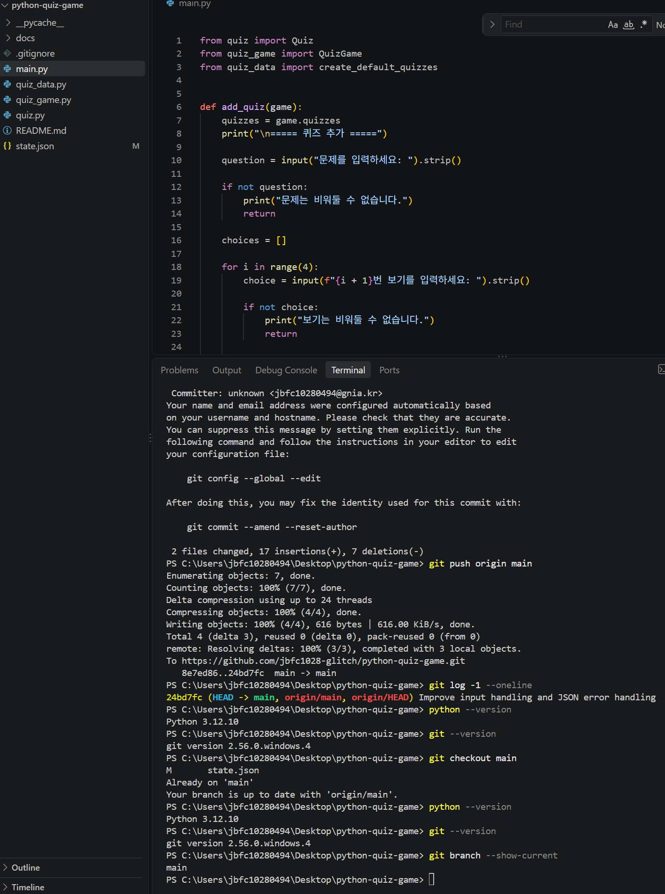
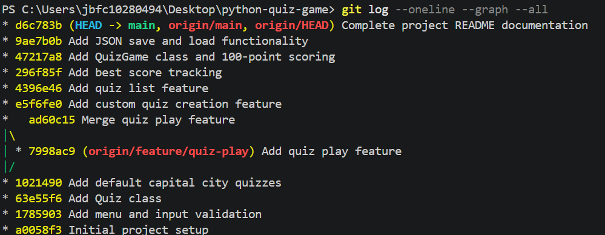
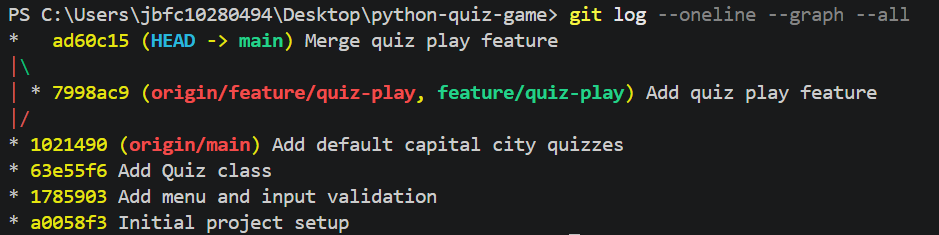
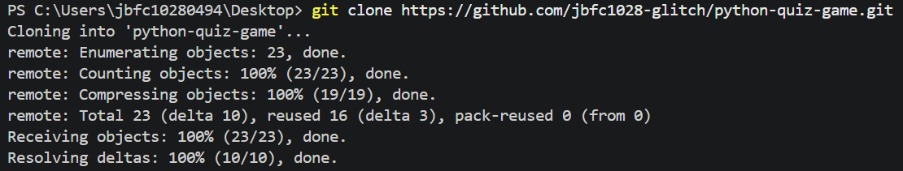

# Python Quiz Game

Python으로 제작한 **터미널 기반 세계 수도 퀴즈 게임**입니다.

사용자는 세계 여러 나라의 수도를 4지선다형 퀴즈로 풀고, 새로운 문제를 직접 추가할 수 있습니다. 퀴즈 목록과 최고 점수는 JSON 파일에 저장되어 프로그램을 종료한 뒤에도 유지됩니다.

## 1. 프로젝트 소개

### 제작 목적

Python의 기본 문법을 학습하고, 실제로 실행되는 프로그램을 직접 구현하기 위해 제작했습니다.

이번 프로젝트에서는 다음 내용을 중점적으로 학습했습니다.

- Python의 변수, 조건문, 반복문, 함수와 입출력
- 클래스와 객체를 활용한 기능별 코드 분리
- JSON 파일을 이용한 데이터 저장 및 불러오기
- 잘못된 사용자 입력과 파일 오류 처리
- Git과 GitHub를 활용한 버전 관리 및 브랜치 병합

### 퀴즈 주제 선정 이유

세계 여러 나라의 수도는 친숙하면서도 다양한 문제를 만들 수 있는 주제입니다.

정답과 오답이 명확해 4지선다형 퀴즈로 구현하기에 적합하고, 새로운 문제를 추가하기도 쉬워 학습용 프로젝트의 주제로 선정했습니다.

## 2. 개발 환경

| 항목 | 사용 환경 |
|---|---|
| 프로그래밍 언어 | Python 3.12.10 |
| 개발 도구 | Visual Studio Code |
| 버전 관리 | Git 2.56.0 / GitHub |
| 데이터 저장 | JSON |
| 실행 환경 | Windows PowerShell |

Python 3.10 이상에서 실행할 수 있도록 표준 라이브러리를 사용했으며, 별도의 외부 패키지 설치는 필요하지 않습니다.

### 개발 환경 확인



## 3. 실행 방법

**1. GitHub 저장소 복제**

```bash
git clone https://github.com/jbfc1028-glitch/python-quiz-game.git
```

**2. 프로젝트 폴더로 이동**

```bash
cd python-quiz-game
```

**3. 프로그램 실행**

```bash
python main.py
```

실행하면 다음 메뉴가 표시됩니다.

```text
===== 나라별 수도 퀴즈 게임 =====
1. 퀴즈 풀기
2. 퀴즈 추가
3. 퀴즈 목록
4. 최고 점수 확인
5. 종료
```

원하는 메뉴 번호를 입력해 게임을 이용할 수 있습니다.

## 4. 주요 기능

| 메뉴 | 기능 | 설명 |
|---|---|---|
| 1 | 퀴즈 풀기 | 4지선다형 문제를 풀고 100점 만점으로 점수 계산 |
| 2 | 퀴즈 추가 | 문제, 보기 4개, 정답 번호를 직접 입력 |
| 3 | 퀴즈 목록 | 등록된 문제와 전체 문제 개수 확인 |
| 4 | 최고 점수 확인 | 지금까지 기록한 최고 점수 출력 |
| 5 | 종료 | 게임 데이터를 저장하고 프로그램 종료 |

### 입력 및 오류 처리

프로그램이 잘못된 입력으로 갑자기 종료되지 않도록 예외 처리를 적용했습니다.

- 숫자가 아닌 문자 입력 시 안내 메시지 출력
- 메뉴 및 정답 번호의 허용 범위 확인
- 빈 입력과 입력값 앞뒤 공백 처리
- `Ctrl+C` 또는 입력 종료 시 안전한 종료 처리
- JSON 저장 파일이 없을 때 기본 퀴즈 사용
- JSON 파일이 손상되었을 때 오류 안내 및 기본 데이터 사용
- 파일 저장 중 오류 발생 시 예외 처리

## 5. 프로젝트 구조

```text
python-quiz-game/
├── main.py
├── quiz.py
├── quiz_game.py
├── quiz_data.py
├── state.json
├── docs/
│   └── screenshots/
├── .gitignore
└── README.md
```

| 파일 | 역할 |
|---|---|
| `main.py` | 메인 메뉴, 입력 처리, 퀴즈 진행 및 추가 |
| `quiz.py` | `Quiz` 클래스와 문제 출력 및 정답 확인 |
| `quiz_game.py` | `QuizGame` 클래스, 최고 점수와 JSON 저장 관리 |
| `quiz_data.py` | 기본 세계 수도 퀴즈 데이터 생성 |
| `state.json` | 퀴즈 목록과 최고 점수 저장 |
| `docs/screenshots/` | 실행 결과와 Git 실습 증빙 이미지 |
| `README.md` | 프로젝트 설명 및 사용 방법 |

### 프로젝트 설계 — 두 개의 클래스로 역할 분리

이 프로젝트는 하나의 클래스에 모든 기능을 넣는 대신, **`Quiz` 클래스와 `QuizGame` 클래스**로 역할을 나누어 구현했습니다.

각 클래스가 담당하는 기능을 분리하여 코드를 이해하고 관리하기 쉽게 만들었습니다.

#### 클래스 구조

```text
           [Python 퀴즈 게임]
                   |
          +--------+--------+
          |                 |
          v                 v
     [Quiz 클래스]     [QuizGame 클래스]
       quiz.py          quiz_game.py
          |                 |
      개별 문제 관리       게임 데이터 관리
          |                 |
      - 문제 내용         - 전체 퀴즈 목록
      - 선택지 4개        - 최고 점수
      - 정답 번호         - 최고 점수 갱신
      - 문제 출력         - JSON 저장
      - 정답 확인         - JSON 불러오기
```

#### 1. Quiz 클래스 — 문제 하나를 관리

**파일:** `quiz.py`

```python
class Quiz:
    def __init__(self, question, choices, answer):
        self.question = question
        self.choices = choices
        self.answer = answer

    def show_question(self):
        print(self.question)

        for i, choice in enumerate(self.choices, start=1):
            print(f"{i}. {choice}")

    def check_answer(self, user_answer):
        return self.answer == user_answer
```

**주요 역할**

- `question`: 문제 내용 저장
- `choices`: 4개의 선택지 저장
- `answer`: 정답 번호 저장
- `show_question()`: 문제와 선택지를 화면에 출력
- `check_answer()`: 사용자가 입력한 답이 정답인지 확인

예를 들어 '대한민국의 수도는?'이라는 문제 하나를 `Quiz` 객체로 만들 수 있습니다.

#### 2. QuizGame 클래스 — 전체 퀴즈 데이터 관리

**파일:** `quiz_game.py`

```python
class QuizGame:
    def __init__(self, quizzes, best_score=0):
        self.quizzes = quizzes
        self.best_score = best_score
```

**주요 역할**

- `quizzes`: 여러 개의 Quiz 객체를 목록으로 관리
- `best_score`: 최고 점수 저장
- `update_best_score()`: 새로운 점수와 최고 점수를 비교하고 갱신
- `show_best_score()`: 최고 점수 출력
- `save_state()`: 퀴즈와 점수를 `state.json`에 저장
- `load_state()`: `state.json`에서 저장된 데이터를 불러오기

메뉴와 사용자 입력 흐름은 `main.py`에서 담당하고, `QuizGame`은 게임 데이터 관리와 저장 기능을 담당하도록 구성했습니다.

#### 클래스를 두 개로 나눈 이유

| 구분 | Quiz | QuizGame |
|---|---|---|
| 관리 대상 | 문제 하나 | 여러 문제와 최고 점수 |
| 핵심 기능 | 문제 출력, 정답 확인 | 점수 갱신, 파일 저장·불러오기 |
| 파일 | `quiz.py` | `quiz_game.py` |

**클래스를 나누면 좋은 점**

1. 각 클래스의 역할이 명확해집니다.
2. 문제 출력 방식을 수정할 때는 `Quiz` 클래스를 중심으로 수정할 수 있습니다.
3. 저장 방식이나 최고 점수 기능을 수정할 때는 `QuizGame` 클래스를 중심으로 수정할 수 있습니다.
4. 기능별로 코드를 확인하고 유지보수하기 쉬워집니다.


## 6. JSON 데이터 저장

프로그램에서는 `state.json` 파일을 이용해 퀴즈 목록과 최고 점수를 저장합니다.

프로그램을 다시 실행하면 기존 데이터를 불러오기 때문에 사용자가 추가한 문제와 최고 점수가 유지됩니다.

### 데이터 구조 예시

```json
{
    "best_score": 80,
    "quizzes": [
        {
            "question": "대한민국의 수도는?",
            "choices": [
                "서울",
                "부산",
                "대전",
                "인천"
            ],
            "answer": 1
        }
    ]
}
```

- `best_score`: 최고 점수
- `quizzes`: 퀴즈 목록
- `question`: 문제 내용
- `choices`: 4개의 보기
- `answer`: 정답 번호(1~4)

`json.dump()`를 이용해 데이터를 저장하고, `json.load()`를 이용해 불러옵니다.

저장 파일이 없거나 정상적으로 읽을 수 없는 경우에는 안내 메시지를 출력하고 기본 퀴즈로 시작하도록 구현했습니다.

## 7. 프로그램 실행 및 테스트

### 7-1. 퀴즈 목록 조회

등록된 퀴즈와 전체 문제 개수가 정상적으로 출력되는지 확인했습니다.


### 7-2. 퀴즈 플레이 및 점수 계산

6문제로 진행한 테스트에서 5문제를 맞혀 83점을 획득했습니다.

정답 개수에 따라 100점 만점으로 점수가 계산되는 것을 확인했습니다.


### 7-3. 최고 점수 저장

퀴즈 플레이 후 최고 점수가 83점으로 갱신되는 것을 확인했습니다.

프로그램을 종료하고 다시 실행한 뒤에도 저장된 최고 점수가 유지되는지 테스트했습니다.


### 7-4. 사용자 퀴즈 추가

사용자가 직접 문제와 보기를 입력하고, 새로운 퀴즈가 목록에 등록되는지 확인했습니다.

추가한 문제가 프로그램 재실행 후에도 유지되는지 테스트했습니다.


### 7-5. 예외 처리 테스트

다음 상황을 직접 테스트했습니다.

- 메뉴에 문자, 빈 값, 범위를 벗어난 숫자 입력
- `Ctrl+C`를 이용한 프로그램 종료
- 잘못된 JSON 데이터가 저장된 파일 불러오기
- 백업 파일을 이용한 원본 데이터 복구

이를 통해 입력 오류와 저장 파일 문제에 대응하는 동작을 확인했습니다.

*위 스크린샷은 개발 과정에서 촬영한 테스트 기록이며, 이후 퀴즈를 추가하고 저장 데이터를 갱신했습니다.*

## 8. Git 및 GitHub 개발 과정

### 기능별 커밋

기능을 단계적으로 구현하고 변경 사항을 Git 커밋으로 기록했습니다.

주요 작업은 다음과 같습니다.

1. 프로젝트 초기 설정 및 기본 메뉴 작성
2. `Quiz` 클래스와 기본 퀴즈 구현
3. 퀴즈 플레이 기능 개발
4. 기능 브랜치 병합
5. 퀴즈 추가 및 목록 조회 기능 구현
6. 최고 점수 계산 및 관리
7. JSON 저장 및 불러오기 기능 구현
8. 입력 검증과 오류 처리 개선
9. README 작성 및 실행 결과 스크린샷 추가

### 브랜치 생성 및 병합

퀴즈 플레이 기능을 `feature/quiz-play` 브랜치에서 개발한 뒤 `main` 브랜치에 병합했습니다.

```bash
git checkout main
git merge --no-ff feature/quiz-play
git push origin main
```

`--no-ff` 옵션을 사용하여 브랜치 병합 이력을 별도의 커밋으로 남겼습니다.

**Git 커밋 및 브랜치 기록**



**브랜치 확인**


**브랜치 병합**



### Git Clone 및 Pull 실습

원격 저장소와 로컬 저장소 사이의 변경 사항 동기화를 직접 실습했습니다.

1. 별도 폴더에 GitHub 저장소를 `git clone`으로 복제
2. 복제한 프로젝트의 `README.md` 수정
3. `git add`와 `git commit`으로 변경 사항 기록
4. `git push`로 원격 저장소에 업로드
5. 원본 프로젝트에서 `git pull` 실행
6. `Fast-forward` 결과를 통해 변경 사항 반영 확인

**Git Clone**



**Git Pull**


### 사용한 주요 Git 명령어

| 명령어 | 용도 |
|---|---|
| `git init` | 로컬 저장소 생성 |
| `git add` | 변경 파일 스테이징 |
| `git commit` | 변경 사항 기록 |
| `git push` | 원격 저장소에 커밋 업로드 |
| `git pull` | 원격 변경 사항 가져오기 및 통합 |
| `git checkout` | 브랜치 이동 |
| `git clone` | 원격 저장소 복제 |
| `git branch` | 브랜치 확인 및 관리 |
| `git merge` | 브랜치 병합 |
| `git status` | 작업 상태 확인 |
| `git log` | 커밋 기록 확인 |

## 9. 프로젝트를 통해 배운 점

이번 프로젝트를 통해 Python 문법을 단순히 학습하는 것과 실제 프로그램에 적용하는 것의 차이를 경험했습니다.

처음에는 변수와 조건문, 반복문을 이용해 메뉴와 퀴즈 기능을 구현했고, 이후 함수와 클래스를 활용하여 기능별로 코드를 분리했습니다.

또한 JSON 파일을 이용해 데이터를 저장하면서 프로그램을 종료해도 정보가 유지되는 데이터 영속성의 개념을 이해했습니다.

입력 오류와 저장 파일 손상 상황을 테스트하며 정상적인 실행뿐 아니라 예외 상황까지 고려해야 한다는 점도 배웠습니다.

Git에서는 스테이징, 커밋, 푸시의 차이를 익히고, 기능 브랜치를 병합하거나 별도의 폴더에서 저장소를 복제하고 변경 사항을 가져오는 과정을 직접 실습했습니다.

**이번 프로젝트의 가장 큰 성과는 Python으로 하나의 프로그램을 완성하고, GitHub를 통해 개발 과정과 결과물을 관리해 본 경험입니다.**


## 10. 과제 목표별 핵심 개념 정리

이 장은 프로젝트를 만들면서 사용한 Python과 Git의 기본 개념을 정리한 학습 노트입니다.

각 개념은 **뜻 → 예제 → 퀴즈 게임에서의 활용 → 직접 설명하는 방법** 순서로 정리했습니다.

---

## 10-1. 변수란?

변수는 **데이터를 저장하고 이름을 붙이는 공간**입니다.

```python
name = "철수"
age = 25
score = 80

print(name)
print(score)
```

실행 결과:

```text
철수
80
```

- `name`: 이름을 저장하는 변수
- `age`: 나이를 저장하는 변수
- `score`: 점수를 저장하는 변수
- `=`: 오른쪽 값을 왼쪽 변수에 저장하는 대입 연산자

**퀴즈 게임에서의 활용**

```python
score = 0
score += 1
```

처음에는 점수를 0으로 설정하고, 정답을 맞힐 때마다 1씩 증가시킵니다.

**설명 연습:** "변수는 데이터를 저장하고 나중에 다시 사용하기 위해 이름을 붙이는 것입니다. 제 게임에서는 score 변수로 정답 개수를 관리했습니다."

---

## 10-2. Python의 5가지 주요 자료형

자료형은 **데이터의 종류**를 의미합니다.

| 자료형    | 의미                        | 예시                |
| ------ | ------------------------- | ----------------- |
| `int`  | 정수                        | `10`, `25`, `100` |
| `str`  | 문자열(글자)                   | `"안녕"`, `"서울"`    |
| `bool` | 참 또는 거짓                   | `True`, `False`   |
| `list` | 여러 값을 순서대로 저장             | `["서울", "부산"]`    |
| `dict` | 이름(key)과 값(value)을 짝으로 저장 | `{"name": "철수"}`  |

### ① int — 정수

```python
age = 25
score = 100
```

`int`는 소수점이 없는 정수를 나타냅니다.

```python
number = int("100")
print(number + 20)
```

결과: `120`

`int("100")`은 문자 `"100"`을 숫자 `100`으로 변환합니다.

**설명 연습:** "int는 정수 자료형입니다. 입력받은 숫자 문자열을 실제 숫자로 바꿀 때도 사용합니다."

### ② str — 문자열

```python
name = "철수"
city = "서울"
```

`str`은 글자나 문장을 나타냅니다. 따옴표로 감싸서 작성합니다.

```python
print("10" + "20")
```

결과: `1020`

문자열끼리 `+`를 사용하면 숫자 계산이 아니라 글자가 이어집니다.

**설명 연습:** "str은 문자열입니다. 문제 내용이나 보기처럼 글자로 된 데이터를 저장할 때 사용합니다."

### ③ bool — 참과 거짓

```python
is_correct = True
is_finished = False
```

`bool`은 `True` 또는 `False` 두 가지 값을 가집니다.

```python
answer = 2
print(answer == 2)
```

결과: `True`

`==`는 두 값이 같은지 비교하는 연산자입니다.

**설명 연습:** "bool은 참과 거짓을 나타내는 자료형이고, 제 게임에서는 정답 여부를 판단하는 데 활용할 수 있습니다."

### ④ list — 리스트

리스트는 여러 값을 **순서대로 저장**합니다.

```python
fruits = ["사과", "바나나", "포도"]

print(fruits[0])
print(fruits[2])
```

결과:

```text
사과
포도
```

리스트의 위치 번호는 **0부터 시작**합니다.

\<text>리스트 위치 이해하기\</text>

| 인덱스 | 0  | 1   | 2  |
| --- | -- | --- | -- |
| 값   | 사과 | 바나나 | 포도 |

새로운 값을 추가할 때는 `append()`를 사용합니다.

```python
fruits.append("딸기")
```

**퀴즈 게임에서의 활용**

```python
choices = ["서울", "부산", "대전", "인천"]
```

4개의 보기를 리스트로 관리합니다.

**설명 연습:** "list는 여러 데이터를 순서대로 저장하는 자료형입니다. 제 게임에서는 퀴즈 보기와 전체 퀴즈 목록을 관리하는 데 사용했습니다."

### ⑤ dict — 딕셔너리

딕셔너리는 \*\*키(key)와 값(value)\*\*을 짝으로 저장합니다.

```python
person = {
    "name": "철수",
    "age": 25
}

print(person["name"])
```

결과: `철수`

- `"name"`: 키
- `"철수"`: 값

**퀴즈 게임에서의 활용**

```python
data = {
    "best_score": 80,
    "quizzes": []
}
```

최고 점수와 퀴즈 목록을 이름별로 구분해 저장합니다.

**설명 연습:** "dict는 키와 값을 연결해 저장하는 자료형입니다. 제 게임에서는 JSON에 저장할 데이터를 구성할 때 사용했습니다."

---

## 10-3. 조건문 if / elif / else

조건문은 **조건에 따라 서로 다른 코드를 실행**할 때 사용합니다.

```python
score = 80

if score >= 90:
    print("A")
elif score >= 70:
    print("B")
else:
    print("C")
```

결과: `B`

- `if`: 첫 번째 조건 검사
- `elif`: 앞의 조건이 거짓일 때 다른 조건 검사
- `else`: 위 조건이 모두 거짓일 때 실행
- `:`: 조건문이나 함수 등의 코드 블록 시작
- 들여쓰기: 해당 조건에 속하는 코드 표시

**퀴즈 게임에서의 활용**

```python
if choice == 1:
    play_quiz(game)
elif choice == 2:
    add_quiz(game)
else:
    print("다른 메뉴를 선택했습니다.")
```

사용자가 선택한 메뉴 번호에 따라 다른 기능을 실행합니다.

**설명 연습:** "if, elif, else는 조건에 따라 다른 동작을 실행하는 문법입니다. 제 게임에서는 메뉴 선택과 정답 판정에 사용했습니다."

---

## 10-4. 반복문 for와 while

반복문은 같은 작업을 여러 번 실행하는 문법입니다.

### for — 정해진 데이터나 범위를 순회

```python
for i in range(3):
    print(i)
```

결과:

```text
0
1
2
```

`range(3)`은 0, 1, 2를 차례대로 만들어 줍니다.

```python
fruits = ["사과", "바나나", "포도"]

for fruit in fruits:
    print(fruit)
```

리스트에 들어 있는 과일을 하나씩 출력합니다.

### while — 조건이 참인 동안 반복

```python
number = 1

while number <= 3:
    print(number)
    number += 1
```

결과:

```text
1
2
3
```

### for와 while의 차이

| for               | while              |
| ----------------- | ------------------ |
| 데이터나 범위를 순회할 때 적합 | 조건이 참인 동안 반복할 때 적합 |
| 리스트의 모든 문제 출력     | 올바른 번호를 입력할 때까지 반복 |

**퀴즈 게임에서의 활용**

```python
for quiz in quizzes:
    quiz.show_question()
```

등록된 문제를 하나씩 출제합니다.

```python
while True:
    choice = input("메뉴 번호: ")
    if choice == "5":
        break
```

종료를 선택할 때까지 메뉴 입력을 반복합니다.

`break`는 반복문을 종료하는 명령어입니다.

**설명 연습:** "for는 목록의 데이터를 하나씩 처리할 때 사용하고, while은 조건을 만족하는 동안 계속 반복할 때 사용합니다."

---

## 10-5. 함수와 매개변수, 반환값

함수는 **특정 작업을 수행하는 코드를 하나로 묶은 것**입니다.

```python
def add(a, b):
    return a + b

result = add(3, 5)
print(result)
```

결과: `8`

- `def`: 함수를 정의하는 키워드
- `add`: 함수 이름
- `a`, `b`: 매개변수
- `return`: 계산 결과를 함수 밖으로 반환
- `add(3, 5)`: 함수 호출

### return과 print의 차이

```python
def add(a, b):
    return a + b
```

`return`은 값을 호출한 곳으로 돌려줍니다.

```python
def add(a, b):
    print(a + b)
```

`print`는 화면에 값을 출력합니다.

즉, **return은 결과를 전달하고, print는 결과를 보여줍니다.**

**퀴즈 게임에서의 활용**

```python
def show_quiz_list(quizzes):
    for quiz in quizzes:
        print(quiz.question)
```

퀴즈 목록을 출력하는 기능을 별도 함수로 만들었습니다.

**설명 연습:** "함수는 반복해서 사용할 기능을 묶은 코드입니다. 매개변수로 필요한 값을 전달하고, return으로 결과를 돌려줄 수 있습니다."

---

## 10-6. 클래스와 객체

클래스는 **객체를 만들기 위한 설계도**입니다.

객체는 클래스를 이용해 실제로 만들어진 데이터와 기능의 묶음입니다.

### 기본 예제

```python
class Student:
    def __init__(self, name):
        self.name = name

    def introduce(self):
        print(f"안녕하세요. 저는 {self.name}입니다.")

student1 = Student("철수")
student1.introduce()
```

결과:

```text
안녕하세요. 저는 철수입니다.
```


### 구조 이해하기

```text
       [클래스 Student]
        학생 설계도
              |
       객체 생성하기
              |
       +------+------+
       |             |
       v             v
 [객체 student1] [객체 student2]
    이름: 철수       이름: 영희
```

클래스는 설계도이고, 객체는 설계도를 이용해 실제로 만든 것입니다.


### \_\_init__이란?

`__init__`은 객체를 생성할 때 초기 속성값을 설정하는 메서드입니다.

```python
def __init__(self, name):
    self.name = name
```

객체를 생성할 때 전달한 이름을 객체에 저장합니다.

### self란?

`self`는 **현재 객체 자신을 가리키는 매개변수**입니다.

```python
self.name = name
```

현재 객체의 `name` 속성에 전달받은 값을 저장한다는 뜻입니다.

### 속성과 메서드

- **속성(attribute):** 객체가 가지고 있는 데이터. 예: `self.name`
- **메서드(method):** 클래스 안에 정의된 함수. 예: `introduce()`

### 퀴즈 게임의 클래스

**Quiz**

- 문제, 보기, 정답을 속성으로 관리
- 문제 출력과 정답 확인 메서드 제공

**QuizGame**

- 전체 퀴즈 목록과 최고 점수를 관리
- 최고 점수 갱신과 JSON 저장 및 불러오기 담당

**설명 연습:** "클래스는 객체를 만드는 설계도이고, 객체는 그 설계도로 만든 실제 인스턴스입니다. \_\_init__은 객체의 초기값을 설정하고, self는 현재 객체 자신을 가리킵니다."

---

## 10-7. 파일 입출력

파일 입출력은 프로그램이 **파일을 읽거나 파일에 데이터를 쓰는 작업**입니다.

### 파일 쓰기

```python
with open("test.txt", "w", encoding="utf-8") as file:
    file.write("안녕하세요")
```

- `open()`: 파일 열기
- `"w"`: 쓰기 모드
- `encoding="utf-8"`: 문자 인코딩 설정
- `write()`: 파일에 내용 쓰기
- `with`: 작업 후 파일을 자동으로 닫도록 관리

### 파일 읽기

```python
with open("test.txt", "r", encoding="utf-8") as file:
    content = file.read()

print(content)
```

- `"r"`: 읽기 모드
- `read()`: 파일 내용 읽기

**설명 연습:** "파일 입출력은 데이터를 파일에 저장하거나 다시 읽어오는 작업입니다. with open을 사용하면 파일을 안전하게 열고 닫을 수 있습니다."

---

## 10-8. JSON과 데이터 영속성

JSON은 **데이터를 일정한 구조로 표현하고 저장하는 텍스트 형식**입니다.

예시:

```json
{
    "name": "철수",
    "score": 80
}
```

Python에서는 `json` 모듈을 사용합니다.

### JSON 저장

```python
import json

data = {"score": 80}

with open("state.json", "w", encoding="utf-8") as file:
    json.dump(data, file, ensure_ascii=False, indent=4)
```

`json.dump()`는 Python 데이터를 JSON 파일에 저장합니다.

### JSON 불러오기

```python
with open("state.json", "r", encoding="utf-8") as file:
    data = json.load(file)

print(data["score"])
```

`json.load()`는 JSON 파일의 내용을 Python 데이터로 불러옵니다.

### 데이터 영속성이란?

프로그램을 종료해도 저장된 데이터가 사라지지 않고 유지되는 성질입니다.

**퀴즈 게임에서의 활용**

`state.json`에 퀴즈 목록과 최고 점수를 저장해 재실행 후에도 사용할 수 있도록 했습니다.

**설명 연습:** "JSON은 데이터를 구조화해 저장하는 형식입니다. 제 게임에서는 json.dump로 저장하고 json.load로 불러와 프로그램을 종료해도 퀴즈와 최고 점수가 유지되도록 했습니다."

---

## 10-9. try / except 예외 처리

예외 처리는 **프로그램 실행 중 오류가 발생했을 때 대응하는 방법**입니다.

```python
try:
    number = int(input("숫자를 입력하세요: "))
    print(number)
except ValueError:
    print("숫자를 입력해주세요.")
```

사용자가 `abc`를 입력하면 정수로 변환할 수 없어 `ValueError`가 발생합니다.

하지만 `except`에서 오류를 처리하므로 안내 메시지를 출력할 수 있습니다.

### 자주 사용하는 예외

| 예외                  | 의미                  |
| ------------------- | ------------------- |
| `ValueError`        | 값이 올바르지 않아 변환 등에 실패 |
| `TypeError`         | 데이터 자료형이 맞지 않음      |
| `OSError`           | 파일 입출력 등 운영체제 관련 오류 |
| `KeyboardInterrupt` | 사용자가 Ctrl+C로 실행 중단  |
| `EOFError`          | 입력 스트림이 종료됨         |
| `KeyError`          | 딕셔너리에 없는 키에 접근      |

**퀴즈 게임에서의 활용**

잘못된 메뉴 번호 입력, 숫자 변환 실패, 손상된 JSON 파일, Ctrl+C 종료 등을 처리했습니다.

**설명 연습:** "try는 오류가 발생할 수 있는 코드를 실행하는 부분이고, except는 오류가 발생했을 때 처리하는 부분입니다."

---

## 10-10. Git이란?

Git은 **파일의 변경 이력을 기록하고 관리하는 버전 관리 도구**입니다.

코드를 수정한 기록을 남기고, 이전 버전을 확인하거나 여러 브랜치에서 작업할 수 있습니다.

GitHub는 Git 저장소를 인터넷에서 보관하고 공유할 수 있는 서비스입니다.


### Git의 기본 작업 흐름

```text
[작업 폴더]
  코드 작성 및 수정
        |
        | git add
        v
[스테이징 영역]
  기록할 변경 사항 선택
        |
        | git commit
        v
[로컬 저장소]
  내 컴퓨터에 변경 이력 기록
        |
        | git push
        v
[GitHub 원격 저장소]
  인터넷에 커밋 업로드
```

### Git 명령어 7가지

| 명령어            | 의미        | 쉽게 설명                    |
| -------------- | --------- | ------------------------ |
| `git init`     | 저장소 초기화   | Git 기록을 시작               |
| `git add`      | 스테이징      | 기록할 파일 선택                |
| `git commit`   | 변경 이력 기록  | 내 컴퓨터에 작업 기록 저장          |
| `git push`     | 업로드       | 로컬 커밋을 GitHub에 올림        |
| `git pull`     | 가져오기 및 통합 | GitHub의 변경 사항을 내 컴퓨터에 반영 |
| `git checkout` | 브랜치 전환 등  | 다른 브랜치로 이동할 때 사용         |
| `git clone`    | 저장소 복제    | GitHub 프로젝트를 내 컴퓨터에 복사   |

### add / commit / push 차이

```bash
git add main.py
git commit -m "Add quiz feature"
git push origin main
```

1. `add`: 변경한 파일을 기록 대상으로 선택
2. `commit`: 선택한 변경 사항을 로컬 저장소에 기록
3. `push`: 기록한 커밋을 GitHub에 업로드

**설명 연습:** "add는 기록할 변경 사항을 선택하는 것이고, commit은 로컬 저장소에 변경 이력을 남기는 것이며, push는 그 커밋을 GitHub에 업로드하는 것입니다."

---

## 10-11. Git 브랜치와 병합

브랜치는 **기존 개발 흐름과 분리해서 작업할 수 있는 개발 이력의 갈래**입니다.

예를 들어 `main`은 기본 개발 브랜치이고, `feature/quiz-play`는 퀴즈 플레이 기능을 개발하기 위한 브랜치입니다.

### 브랜치 작업 흐름

```text
main
  |
  A ----------- M
   \           /
    B --- C ---
    feature/quiz-play
```

- `A`: 기능 개발 전 커밋
- `B`, `C`: 기능 브랜치에서 작업한 커밋
- `M`: 기능 브랜치를 main에 병합한 커밋

### 브랜치 명령어

```bash
git branch feature/quiz-play
git checkout feature/quiz-play
```

브랜치를 만들고 해당 브랜치로 이동합니다.

```bash
git checkout main
git merge --no-ff feature/quiz-play
```

`main`으로 이동한 뒤 기능 브랜치를 병합합니다.

`--no-ff`는 병합 커밋을 별도로 남기는 옵션입니다.

**설명 연습:** "브랜치는 기존 코드와 분리해서 기능을 개발하기 위해 사용합니다. 기능을 완성하면 merge로 main 브랜치에 합칠 수 있습니다."

---

## 10-12. Git clone과 pull의 차이

### git clone

```bash
git clone https://github.com/jbfc1028-glitch/python-quiz-game.git
```

GitHub 저장소를 내 컴퓨터에 **처음 복제**할 때 사용합니다.

### git pull

```bash
git pull origin main
```

이미 가지고 있는 로컬 저장소에 **원격 저장소의 최신 변경 사항을 가져와 통합**할 때 사용합니다.

| clone          | pull                 |
| -------------- | -------------------- |
| 저장소를 새로 복제     | 기존 저장소 업데이트          |
| 처음 프로젝트를 가져올 때 | 다른 곳에서 변경한 내용을 반영할 때 |

**설명 연습:** "clone은 원격 저장소를 처음 복제하는 것이고, pull은 이미 복제한 저장소에 원격 변경 사항을 가져와 반영하는 것입니다."

---

## 10-13. 과제 핵심 개념 한눈에 복습

| 질문            | 핵심 답변                      |
| ------------- | -------------------------- |
| 변수란?          | 데이터를 저장하고 이름을 붙이는 것        |
| int란?         | 정수 자료형                     |
| str이란?        | 문자열 자료형                    |
| bool이란?       | 참과 거짓을 나타내는 자료형            |
| list란?        | 여러 값을 순서대로 저장하는 자료형        |
| dict란?        | 키와 값의 쌍으로 저장하는 자료형         |
| if란?          | 조건에 따라 코드를 실행하는 문법         |
| for란?         | 데이터나 범위를 순회하는 반복문          |
| while이란?      | 조건이 참인 동안 실행하는 반복문         |
| 함수란?          | 특정 기능을 수행하는 코드를 묶은 것       |
| 매개변수란?        | 함수가 전달받는 값을 저장하는 변수        |
| return이란?     | 함수의 결과를 호출한 곳으로 반환         |
| 클래스란?         | 객체를 만들기 위한 설계도             |
| 객체란?          | 클래스로 생성한 실제 인스턴스           |
| \_\_init__이란? | 객체 생성 시 초기값을 설정하는 메서드      |
| self란?        | 현재 객체 자신을 가리키는 매개변수        |
| 속성이란?         | 객체가 가지고 있는 데이터             |
| 메서드란?         | 클래스 안에 정의된 함수              |
| JSON이란?       | 구조화된 데이터를 표현하는 텍스트 형식      |
| json.dump란?   | Python 데이터를 JSON 파일에 저장    |
| json.load란?   | JSON 파일에서 데이터를 읽어오기        |
| try/except란?  | 실행 중 발생하는 예외를 처리하는 문법      |
| Git이란?        | 코드 변경 이력을 관리하는 도구          |
| GitHub란?      | Git 저장소를 온라인에서 보관·공유하는 서비스 |
| add란?         | 기록할 변경 사항 선택               |
| commit이란?     | 로컬 저장소에 변경 이력 기록           |
| push란?        | 로컬 커밋을 원격 저장소에 업로드         |
| pull이란?       | 원격 변경 사항을 가져와 통합           |
| checkout이란?   | 브랜치 전환 등 작업                |
| clone이란?      | 원격 저장소 복제                  |
| merge란?       | 브랜치의 변경 이력을 병합             |

---

## 10-14. 프로젝트를 한 문장으로 설명하기

"Python의 기본 문법과 클래스, JSON 파일 입출력을 활용해 세계 수도 퀴즈 게임을 만들었고, Git과 GitHub로 기능별 개발 이력을 기록하고 브랜치를 병합했습니다."

### 프로젝트에서 가장 중요하게 배운 세 가지

1. **Python:** 변수, 조건문, 반복문, 함수, 클래스를 조합해 실제 프로그램을 만들 수 있다는 점
2. **JSON:** 프로그램을 종료해도 퀴즈와 최고 점수를 파일에 저장해 유지할 수 있다는 점
3. **Git:** 코드를 수정할 때마다 변경 이력을 기록하고 GitHub에 업로드하며 관리할 수 있다는 점
