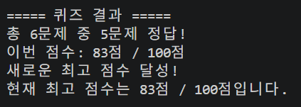

# Python Quiz Game

Python으로 제작한 **터미널 기반 세계 수도 퀴즈 게임**입니다.

사용자는 세계 여러 나라의 수도를 4지선다형 퀴즈로 풀고, 새로운 문제를 직접 추가할 수 있습니다. 퀴즈 목록과 최고 점수는 JSON 파일에 저장되어 프로그램을 종료한 뒤에도 유지됩니다.

## 1. 프로젝트 소개

### 제작 목적

Python의 기본 문법을 학습하고, 실제로 실행되는 프로그램을 직접 구현하기 위해 제작했습니다.

이번 프로젝트에서는 다음 내용을 중점적으로 학습했습니다.

- Python의 변수, 조건문, 반복문, 함수와 입출력
- 클래스와 객체를 활용한 기능별 코드 분리
- JSON 파일을 이용한 데이터 저장 및 불러오기
- 잘못된 사용자 입력과 파일 오류 처리
- Git과 GitHub를 활용한 버전 관리 및 브랜치 병합

### 퀴즈 주제 선정 이유

세계 여러 나라의 수도는 친숙하면서도 다양한 문제를 만들 수 있는 주제입니다.

정답과 오답이 명확해 4지선다형 퀴즈로 구현하기에 적합하고, 새로운 문제를 추가하기도 쉬워 학습용 프로젝트의 주제로 선정했습니다.

## 2. 개발 환경

| 항목 | 사용 환경 |
|---|---|
| 프로그래밍 언어 | Python 3.12.10 |
| 개발 도구 | Visual Studio Code |
| 버전 관리 | Git 2.56.0 / GitHub |
| 데이터 저장 | JSON |
| 실행 환경 | Windows PowerShell |

Python 3.10 이상에서 실행할 수 있도록 표준 라이브러리를 사용했으며, 별도의 외부 패키지 설치는 필요하지 않습니다.

### 개발 환경 확인


## 3. 실행 방법

**1. GitHub 저장소 복제**

```bash
git clone https://github.com/jbfc1028-glitch/python-quiz-game.git
```

**2. 프로젝트 폴더로 이동**

```bash
cd python-quiz-game
```

**3. 프로그램 실행**

```bash
python main.py
```

실행하면 다음 메뉴가 표시됩니다.

```text
===== 나라별 수도 퀴즈 게임 =====
1. 퀴즈 풀기
2. 퀴즈 추가
3. 퀴즈 목록
4. 최고 점수 확인
5. 종료
```

원하는 메뉴 번호를 입력해 게임을 이용할 수 있습니다.

## 4. 주요 기능

| 메뉴 | 기능 | 설명 |
|---|---|---|
| 1 | 퀴즈 풀기 | 4지선다형 문제를 풀고 100점 만점으로 점수 계산 |
| 2 | 퀴즈 추가 | 문제, 보기 4개, 정답 번호를 직접 입력 |
| 3 | 퀴즈 목록 | 등록된 문제와 전체 문제 개수 확인 |
| 4 | 최고 점수 확인 | 지금까지 기록한 최고 점수 출력 |
| 5 | 종료 | 게임 데이터를 저장하고 프로그램 종료 |

### 입력 및 오류 처리

프로그램이 잘못된 입력으로 갑자기 종료되지 않도록 예외 처리를 적용했습니다.

- 숫자가 아닌 문자 입력 시 안내 메시지 출력
- 메뉴 및 정답 번호의 허용 범위 확인
- 빈 입력과 입력값 앞뒤 공백 처리
- `Ctrl+C` 또는 입력 종료 시 안전한 종료 처리
- JSON 저장 파일이 없을 때 기본 퀴즈 사용
- JSON 파일이 손상되었을 때 오류 안내 및 기본 데이터 사용
- 파일 저장 중 오류 발생 시 예외 처리

## 5. 프로젝트 구조

```text
python-quiz-game/
├── main.py
├── quiz.py
├── quiz_game.py
├── quiz_data.py
├── state.json
├── docs/
│   └── screenshots/
├── .gitignore
└── README.md
```

| 파일 | 역할 |
|---|---|
| `main.py` | 메인 메뉴, 입력 처리, 퀴즈 진행 및 추가 |
| `quiz.py` | `Quiz` 클래스와 문제 출력 및 정답 확인 |
| `quiz_game.py` | `QuizGame` 클래스, 최고 점수와 JSON 저장 관리 |
| `quiz_data.py` | 기본 세계 수도 퀴즈 데이터 생성 |
| `state.json` | 퀴즈 목록과 최고 점수 저장 |
| `docs/screenshots/` | 실행 결과와 Git 실습 증빙 이미지 |
| `README.md` | 프로젝트 설명 및 사용 방법 |

### 클래스 설계

**Quiz 클래스**

개별 퀴즈의 문제, 보기, 정답을 관리합니다. 문제를 출력하고 사용자가 선택한 답이 정답인지 확인하는 역할을 담당합니다.

**QuizGame 클래스**

전체 퀴즈 목록과 최고 점수를 관리합니다. JSON 파일에 데이터를 저장하거나 기존 데이터를 불러오는 역할을 담당합니다.

이처럼 클래스별 역할을 나누어 프로그램의 구조를 정리했습니다.

## 6. JSON 데이터 저장

프로그램에서는 `state.json` 파일을 이용해 퀴즈 목록과 최고 점수를 저장합니다.

프로그램을 다시 실행하면 기존 데이터를 불러오기 때문에 사용자가 추가한 문제와 최고 점수가 유지됩니다.

### 데이터 구조 예시

```json
{
    "best_score": 80,
    "quizzes": [
        {
            "question": "대한민국의 수도는?",
            "choices": [
                "서울",
                "부산",
                "대전",
                "인천"
            ],
            "answer": 1
        }
    ]
}
```

- `best_score`: 최고 점수
- `quizzes`: 퀴즈 목록
- `question`: 문제 내용
- `choices`: 4개의 보기
- `answer`: 정답 번호(1~4)

`json.dump()`를 이용해 데이터를 저장하고, `json.load()`를 이용해 불러옵니다.

저장 파일이 없거나 정상적으로 읽을 수 없는 경우에는 안내 메시지를 출력하고 기본 퀴즈로 시작하도록 구현했습니다.

## 7. 프로그램 실행 및 테스트

### 7-1. 퀴즈 목록 조회

등록된 퀴즈와 전체 문제 개수가 정상적으로 출력되는지 확인했습니다.


### 7-2. 퀴즈 플레이 및 점수 계산

6문제로 진행한 테스트에서 5문제를 맞혀 83점을 획득했습니다.

정답 개수에 따라 100점 만점으로 점수가 계산되는 것을 확인했습니다.



### 7-3. 최고 점수 저장

퀴즈 플레이 후 최고 점수가 83점으로 갱신되는 것을 확인했습니다.

프로그램을 종료하고 다시 실행한 뒤에도 저장된 최고 점수가 유지되는지 테스트했습니다.


### 7-4. 사용자 퀴즈 추가

사용자가 직접 문제와 보기를 입력하고, 새로운 퀴즈가 목록에 등록되는지 확인했습니다.

추가한 문제가 프로그램 재실행 후에도 유지되는지 테스트했습니다.


### 7-5. 예외 처리 테스트

다음 상황을 직접 테스트했습니다.

- 메뉴에 문자, 빈 값, 범위를 벗어난 숫자 입력
- `Ctrl+C`를 이용한 프로그램 종료
- 잘못된 JSON 데이터가 저장된 파일 불러오기
- 백업 파일을 이용한 원본 데이터 복구

이를 통해 입력 오류와 저장 파일 문제에 대응하는 동작을 확인했습니다.

*위 스크린샷은 개발 과정에서 촬영한 테스트 기록이며, 이후 퀴즈를 추가하고 저장 데이터를 갱신했습니다.*

## 8. Git 및 GitHub 개발 과정

### 기능별 커밋

기능을 단계적으로 구현하고 변경 사항을 Git 커밋으로 기록했습니다.

주요 작업은 다음과 같습니다.

1. 프로젝트 초기 설정 및 기본 메뉴 작성
2. `Quiz` 클래스와 기본 퀴즈 구현
3. 퀴즈 플레이 기능 개발
4. 기능 브랜치 병합
5. 퀴즈 추가 및 목록 조회 기능 구현
6. 최고 점수 계산 및 관리
7. JSON 저장 및 불러오기 기능 구현
8. 입력 검증과 오류 처리 개선
9. README 작성 및 실행 결과 스크린샷 추가

### 브랜치 생성 및 병합

퀴즈 플레이 기능을 `feature/quiz-play` 브랜치에서 개발한 뒤 `main` 브랜치에 병합했습니다.

```bash
git checkout main
git merge --no-ff feature/quiz-play
git push origin main
```

`--no-ff` 옵션을 사용하여 브랜치 병합 이력을 별도의 커밋으로 남겼습니다.

**Git 커밋 및 브랜치 기록**


**브랜치 확인**


**브랜치 병합**


### Git Clone 및 Pull 실습

원격 저장소와 로컬 저장소 사이의 변경 사항 동기화를 직접 실습했습니다.

1. 별도 폴더에 GitHub 저장소를 `git clone`으로 복제
2. 복제한 프로젝트의 `README.md` 수정
3. `git add`와 `git commit`으로 변경 사항 기록
4. `git push`로 원격 저장소에 업로드
5. 원본 프로젝트에서 `git pull` 실행
6. `Fast-forward` 결과를 통해 변경 사항 반영 확인

**Git Clone**


**Git Pull**


### 사용한 주요 Git 명령어

| 명령어 | 용도 |
|---|---|
| `git init` | 로컬 저장소 생성 |
| `git add` | 변경 파일 스테이징 |
| `git commit` | 변경 사항 기록 |
| `git push` | 원격 저장소에 커밋 업로드 |
| `git pull` | 원격 변경 사항 가져오기 및 통합 |
| `git checkout` | 브랜치 이동 |
| `git clone` | 원격 저장소 복제 |
| `git branch` | 브랜치 확인 및 관리 |
| `git merge` | 브랜치 병합 |
| `git status` | 작업 상태 확인 |
| `git log` | 커밋 기록 확인 |

## 9. 프로젝트를 통해 배운 점

이번 프로젝트를 통해 Python 문법을 단순히 학습하는 것과 실제 프로그램에 적용하는 것의 차이를 경험했습니다.

처음에는 변수와 조건문, 반복문을 이용해 메뉴와 퀴즈 기능을 구현했고, 이후 함수와 클래스를 활용하여 기능별로 코드를 분리했습니다.

또한 JSON 파일을 이용해 데이터를 저장하면서 프로그램을 종료해도 정보가 유지되는 데이터 영속성의 개념을 이해했습니다.

입력 오류와 저장 파일 손상 상황을 테스트하며 정상적인 실행뿐 아니라 예외 상황까지 고려해야 한다는 점도 배웠습니다.

Git에서는 스테이징, 커밋, 푸시의 차이를 익히고, 기능 브랜치를 병합하거나 별도의 폴더에서 저장소를 복제하고 변경 사항을 가져오는 과정을 직접 실습했습니다.

**이번 프로젝트의 가장 큰 성과는 Python으로 하나의 프로그램을 완성하고, GitHub를 통해 개발 과정과 결과물을 관리해 본 경험입니다.**